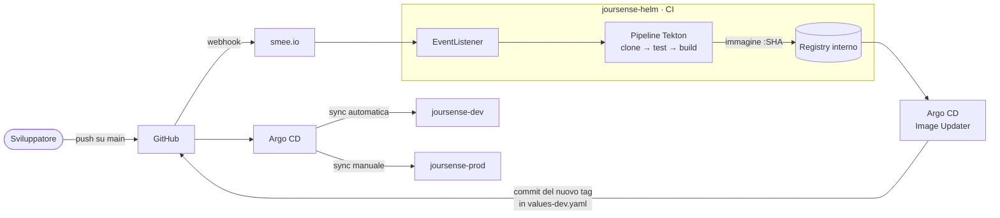

# Joursense su OpenShift

**Joursense** è il giornalino interno dell'ufficio: una web app FastAPI con database PostgreSQL
(notizie, classifica degli articoli più letti, meteo, minigiochi, dipendente del mese).
Il funzionamento dell'app è descritto in [`joursense/README.md`](joursense/README.md).

Questa repo raccoglie tutto il necessario per costruirla, installarla e gestirla su
**OpenShift** come in un progetto reale: pipeline CI, deploy GitOps con due ambienti,
autoscaling, backup e ripristino, monitoring e limiti di risorse.

Tutto è descritto **come codice** (YAML, chart Helm, documentazione) e **nessuna password è
nella repo**: le credenziali stanno in Secret creati a parte sul cluster.

---

## Il quadro generale



1. Un push su `main` che modifica il codice (`joursense/`) arriva tramite webhook a un
   EventListener Tekton.
2. La **pipeline** clona il codice, esegue i test e costruisce l'immagine, taggata con lo SHA
   del commit. Se un test fallisce si ferma.
3. L'**Image Updater** si accorge della nuova immagine e scrive il tag in `values-dev.yaml`,
   con un commit su GitHub.
4. **Argo CD** applica il chart Helm: in **dev** subito (sync automatica), in **prod** solo
   quando una persona lo decide (sync manuale).

La CI (Tekton) produce e verifica l'immagine; il CD (Argo CD) la porta negli ambienti. Lo stato
di ogni ambiente è descritto in Git: per sapere cosa gira in dev o in prod basta leggere i
rispettivi file di values.

## Namespace

| Namespace | Contenuto |
|---|---|
| `joursense-helm` | CI: pipeline Tekton, EventListener, smee-client, immagini dell'app. È anche l'ambiente su cui sono state sviluppate le fasi 1 e 2 |
| `joursense-dev` | ambiente di sviluppo: una replica, risorse ridotte, niente backup né alert |
| `joursense-prod` | ambiente di produzione: HPA da 2 a 5 pod, più risorse, backup notturno, alert |
| `openshift-gitops` | Argo CD, Application e Image Updater |
| `openshift-pipelines` | Task di cluster fornite dall'operatore (git-clone, buildah) |

## Tecnologie

| Strumento | Uso |
|---|---|
| OpenShift | piattaforma: Route, ImageStream, registry interno, SCC, monitoring |
| Helm | chart unico `joursense-helm`, con un file di values per ambiente |
| OpenShift Pipelines (Tekton) | CI: clone, test, build dell'immagine |
| Tekton Triggers + smee.io | avvio della pipeline da webhook GitHub |
| pytest | test di `/healthz`, eseguiti dalla pipeline |
| OpenShift GitOps (Argo CD) | deploy negli ambienti dev e prod |
| Argo CD Image Updater | aggiorna in Git il tag dell'immagine di dev |
| HorizontalPodAutoscaler + hey | autoscaling sulla CPU e load test |
| CronJob + pg_dump / pg_restore | backup del database e ripristino |
| Prometheus (monitoring di OpenShift) | alert con PrometheusRule e dashboard in console |
| ResourceQuota + LimitRange | limiti di risorse per namespace |
| NetworkPolicy | `default-deny-all` e solo il traffico necessario |

## Struttura della repo

```
joursense/                 codice dell'app, Containerfile, test pytest
joursense-helm/            chart Helm (unico per tutti gli ambienti)
├── values.yaml            valori di base
├── values-dev.yaml        differenze per dev
└── values-prod.yaml       differenze per prod
joursense-ops/             tutto ciò che non sta nel chart
├── operators/             Subscription di OpenShift Pipelines e OpenShift GitOps
├── tekton/                pipeline, Task, ServiceAccount, webhook
├── probe/                 probe di liveness e readiness, email fuori dai values
├── hpa/                   autoscaling e load test
├── backup/                CronJob di backup
├── restore/               procedura di ripristino
├── monitoring/            alert, dashboard, configurazione del monitoring
├── ambienti/              dev e prod dallo stesso chart
├── argocd/                Application di Argo CD e Image Updater
└── quota/                 ResourceQuota e LimitRange
```

Ogni cartella di `joursense-ops/` ha un **README** con i dettagli: file, comandi,
spiegazioni e verifiche.

Criterio usato per decidere cosa va nel chart e cosa in `joursense-ops/`: nel chart c'è ciò che
appartiene all'app e si installa con i permessi del progetto; in `joursense-ops/` ciò che
richiede un cluster-admin (operatori, quote, dashboard, configurazione del monitoring) o che
non fa parte dell'app (pipeline, Application di Argo CD, strumenti di test).

---

## CI/CD con OpenShift Pipelines

| Attività | Come | Dettagli |
|---|---|---|
| Operatore OpenShift Pipelines | Subscription YAML, canale `pipelines-1.24` | [`operators/`](joursense-ops/operators/README.md) |
| Pipeline Tekton | `fetch-source` → `test` → `build-push`; ogni passo parte solo se il precedente è riuscito | [`tekton/`](joursense-ops/tekton/README.md) |
| Test pytest su `/healthz` | 3 test, senza bisogno di PostgreSQL; se falliscono la build non parte | [`tekton/`](joursense-ops/tekton/README.md#3-test-con-pytest) |
| ServiceAccount dedicato | `pipeline-service-account` con un Role limitato al namespace e alle sole risorse necessarie | [`tekton/`](joursense-ops/tekton/README.md#4-serviceaccount-dedicato-con-permessi-minimi) |
| Webhook GitHub + EventListener | GitHub → smee.io → `smee-client` → EventListener; firma verificata, solo push su `main` che modificano `joursense/` | [`tekton/`](joursense-ops/tekton/README.md#5-webhook-github-ed-eventlistener) |

Nella prima versione la pipeline aveva un quarto passo, `deploy` con `helm upgrade`. Con la
fase 3 il deploy è passato ad Argo CD e la pipeline si occupa solo di CI.

## Affidabilità e osservabilità

| Attività | Come | Dettagli |
|---|---|---|
| Probe | liveness su `/healthz` (solo il processo), readiness su `/readyz` (anche il database) | [`probe/`](joursense-ops/probe/README.md) |
| Email fuori dai values | indirizzi degli admin nel Secret `joursense-admin` | [`probe/`](joursense-ops/probe/README.md#email-fuori-dai-values) |
| HPA e load test | da 1 a 5 pod al 50% della CPU richiesta, verificato con `hey` | [`hpa/`](joursense-ops/hpa/README.md) |
| Backup | CronJob notturno con `pg_dump -Fc` (compresso) su un PVC separato, con conservazione limitata | [`backup/`](joursense-ops/backup/README.md) |
| Ripristino | backup del CronJob ripristinato su un Postgres vuoto e confrontato con la produzione | [`restore/`](joursense-ops/restore/README.md) |
| Alert | PrometheusRule `PodNonReady`: pod attivo ma non ready da 2 minuti | [`monitoring/`](joursense-ops/monitoring/README.md) |
| Dashboard | dashboard `joursense` nella console: pod ready, repliche HPA, CPU, memoria, restart | [`monitoring/`](joursense-ops/monitoring/README.md#dashboard-joursense) |

## Ambienti e GitOps

| Attività | Come | Dettagli |
|---|---|---|
| Operatore OpenShift GitOps | Subscription YAML, canale `gitops-1.22` | [`operators/`](joursense-ops/operators/README.md) |
| Due ambienti dallo stesso chart | `values-dev.yaml` e `values-prod.yaml` contengono solo le differenze | [`ambienti/`](joursense-ops/ambienti/README.md) |
| Deploy con Argo CD | Application `joursense-dev` (sync automatica) e `joursense-prod` (sync manuale); Image Updater per dev | [`argocd/`](joursense-ops/argocd/README.md) |
| Quote e limiti | ResourceQuota e LimitRange in dev e prod, dimensionati sul caso peggiore (HPA al massimo, backup, rolling update) | [`quota/`](joursense-ops/quota/README.md) |

### Differenze tra gli ambienti

| | dev | prod |
|---|---|---|
| Repliche app | 1 fissa | HPA da 2 a 5 |
| Risorse app (requests / limits) | 50m, 128Mi / 250m, 256Mi | 200m, 512Mi / 1, 1Gi |
| Backup | no | ogni notte, PVC da 4Gi, 7 giorni |
| Alert | no | sì |
| Sync di Argo CD | automatica | manuale |
| Aggiornamento dell'immagine | automatico (Image Updater) | manuale del tag in `values-prod.yaml` |

---

## Segreti

Questi Secret sono
creati a mano sul cluster:

| Secret | Namespace | Contenuto | Usato da |
|---|---|---|---|
| `postgres-credentials` | ogni ambiente | nome del database, utente, password | app, PostgreSQL, backup |
| `joursense-admin` | ogni ambiente | email degli amministratori | app |
| `github-webhook-secret` | `joursense-helm` | segreto condiviso con il webhook GitHub | EventListener |
| `git-creds-joursense` | `openshift-gitops` | token GitHub per i commit dell'Image Updater | Image Updater |
| `image-updater-registry-pull` | `openshift-gitops` | accesso in lettura al registry interno | Image Updater |

Nella repo restano solo i **riferimenti** a questi Secret (nomi e chiavi), mai i valori.

## Installazione da zero

L'ordine conta: ogni passo usa quello che crea il precedente. I comandi esatti sono nei README
indicati.

**Da cluster-admin (una volta sola)**

1. Operatori OpenShift Pipelines e OpenShift GitOps → [`operators/`](joursense-ops/operators/README.md)
2. Monitoring dei progetti utente (`enableUserWorkload`) e dashboard → [`monitoring/`](joursense-ops/monitoring/README.md)
3. Namespace `joursense-helm`, `joursense-dev`, `joursense-prod`, permessi del team e label per Argo CD → [`argocd/`](joursense-ops/argocd/README.md), [`ambienti/`](joursense-ops/ambienti/README.md)
4. ResourceQuota e LimitRange → [`quota/`](joursense-ops/quota/README.md)
5. ServiceAccount e Role della pipeline, ServiceAccount dell'EventListener → [`tekton/`](joursense-ops/tekton/README.md)
6. Image Updater: attivazione, accesso al registry, token GitHub → [`argocd/`](joursense-ops/argocd/README.md)

**Dal team**

7. Secret di ogni ambiente (`postgres-credentials`, `joursense-admin`) e del webhook
8. Pipeline, Task, trigger, smee-client e NetworkPolicy del webhook → [`tekton/`](joursense-ops/tekton/README.md)
9. Webhook su GitHub e prima build dell'immagine
10. Application di Argo CD: dev si sincronizza da sola, prod con un Sync manuale → [`argocd/`](joursense-ops/argocd/README.md)
