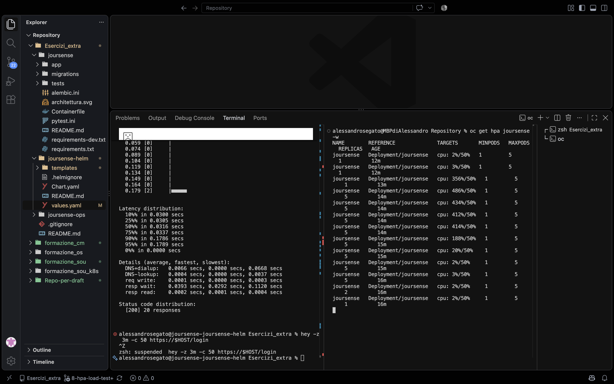

# Autoscaling di joursense (HPA)

Un HorizontalPodAutoscaler che aggiunge e toglie pod dell'app in base alla CPU,
verificato con un load test fatto con `hey`.

## Cosa c'è e dove sta

| Oggetto | File | Cosa fa |
|---|---|---|
| HPA `joursense` | `joursense-helm/templates/hpa.yaml` | scala il Deployment `joursense` da 1 a 5 pod |
| Configurazione | `joursense-helm/values.yaml` → `app.autoscaling` | limiti, target CPU, tempi |
| Deployment | `joursense-helm/templates/deployment.yaml` | `replicas` scritto solo se l'HPA è spento |

Tutto è nel chart: l'HPA si installa con il normale `helm upgrade`, anche dalla pipeline Tekton.

## Configurazione

```yaml
app:
  resources:
    requests:
      cpu: 100m
  autoscaling:
    enabled: true
    minReplicas: 1
    maxReplicas: 5
    targetCPUUtilizationPercentage: 50
    scaleDownStabilizationSeconds: 60
```

- **Target 50%**: l'HPA cerca di tenere la CPU media dei pod al 50% della **request**.
  Con `100m` aggiunge pod quando la media supera `50m`.
- **`requests.cpu` è obbligatorio**: senza, l'HPA non sa su cosa calcolare la percentuale
  e mostra `<unknown>/50%`.
- **`scaleDownStabilizationSeconds: 60`**: finito il carico, aspetta 60 secondi prima di
  togliere pod.

### Perché `replicas` è condizionale nel Deployment

```yaml
spec:
  {{- if not .Values.app.autoscaling.enabled }}
  replicas: {{ .Values.app.replicas }}
  {{- end }}
```

Con l'HPA attivo il numero di pod lo decide lui. Se il Deployment avesse `replicas: 1`
fisso, a ogni `helm upgrade` (e la pipeline ne fa uno a ogni push) Helm riporterebbe i pod
a 1, andando contro l'HPA.

## Deploy e verifica

```bash
helm upgrade joursense ./joursense-helm --reset-then-reuse-values
oc get hpa
```

Risultato atteso (dopo 30-60 secondi):

```
NAME        REFERENCE              TARGETS       MINPODS   MAXPODS   REPLICAS
joursense   Deployment/joursense   cpu: 2%/50%   1         5         1
```

## Load test con hey

`hey` genera tante richieste HTTP contemporanee, come molti utenti insieme: la CPU del
pod sale e l'HPA deve reagire.

```bash
brew install hey
HOST=$(oc get route joursense -o jsonpath='{.spec.host}')

# prova leggera: devono essere tutte 200
hey -n 20 -c 2 https://$HOST/login

# carico vero: 50 utenti contemporanei per 3 minuti
hey -z 3m -c 50 https://$HOST/login
```

In un secondo terminale:

```bash
oc get hpa joursense -w
```

- **Endpoint `/login`**: non richiede di essere autenticati e genera una pagina HTML vera,
  quindi fa lavorare la CPU.

### Esito

- Prova leggera: 20/20 risposte `200`, tempo medio circa 46 ms.
- Carico: TARGETS ben oltre il 50%, REPLICAS salite progressivamente verso il massimo.
- Fine del test: dopo circa 60 secondi di calma le repliche sono tornate a 1.

### Screenshot

`oc get hpa -w` durante il load test: le repliche salgono con la CPU sopra il 50%.

