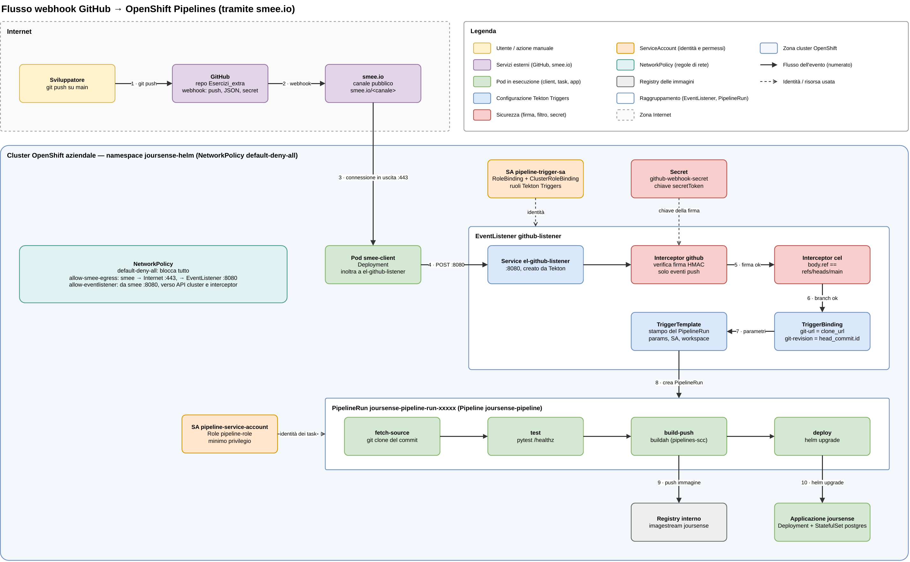

# Pipeline CI/CD di joursense (OpenShift Pipelines / Tekton)

A ogni push su `main` una pipeline Tekton scarica il codice, esegue i test, costruisce
l'immagine e aggiorna l'app con `helm upgrade`.



I numeri sulle frecce seguono il percorso dell'evento: dal push (1) al deploy (10). Le frecce
tratteggiate indicano l'identità (ServiceAccount) o la risorsa (Secret) usata in quel punto.

## File

| File | Oggetto | Ruolo |
|---|---|---|
| `operators/openshift-pipelines-subscription.yaml` | Subscription | installa l'operatore OpenShift Pipelines |
| `tekton/pipeline.yaml` | Pipeline `joursense-pipeline` | i 4 passi: clone, test, build, deploy |
| `tekton/task-run-tests.yaml` | Task `run-tests` | esegue `pytest` |
| `tekton/task-helm-upgrade-tekton.yaml` | Task `helm-upgrade` | deploy con `helm upgrade --install` |
| `tekton/serviceaccount-pipeline.yaml` | ServiceAccount, Role, RoleBinding | identità e permessi minimi della pipeline |
| `tekton/eventlistener-sa.yaml` | ServiceAccount e binding | identità dell'EventListener |
| `tekton/eventlistener.yaml` | EventListener `github-listener` | riceve il webhook, filtra push su `main` |
| `tekton/triggerbinding.yaml` | TriggerBinding | estrae URL e commit dal payload di GitHub |
| `tekton/triggertemplate.yaml` | TriggerTemplate | crea la PipelineRun |
| `tekton/smee-client.yaml` | Deployment `smee-client` | inoltra il webhook da smee.io al cluster |
| `tekton/networkpolicy-webhook.yaml` | NetworkPolicy | aprono il percorso smee-client → EventListener |
| `joursense/tests/` | test pytest | verificano `/healthz` |

Tutto è nel namespace `joursense-helm`.

## 1. Operatore OpenShift Pipelines

Installato da YAML, tramite OLM, invece che dalla console. Da un cluster-admin:

```bash
oc apply -f joursense-ops/operators/openshift-pipelines-subscription.yaml
oc get csv -n openshift-operators | grep pipelines      # Succeeded
```

La Subscription segue il canale `pipelines-1.24` con aggiornamenti automatici. L'operatore
fornisce Tekton, Tekton Triggers e le Task di cluster usate dalla pipeline
(`git-clone-1-24-0`, `buildah-1-24-0` nel namespace `openshift-pipelines`).

## 2. La pipeline

### I passi

`joursense-pipeline` (`tekton/pipeline.yaml`) ha quattro Task. Ognuna ha `runAfter` sulla
precedente: parte solo se quella prima è riuscita, quindi un errore in un passo ferma tutti
quelli dopo.

| # | Task | Tipo | Cosa fa |
|---|---|---|---|
| 1 | `fetch-source` | `git-clone-1-24-0`, Task di cluster | clona la repo al commit richiesto; produce il risultato `COMMIT` (SHA) |
| 2 | `test` | `run-tests`, nostra | installa le dipendenze ed esegue `pytest` |
| 3 | `build-push` | `buildah-1-24-0`, Task di cluster | costruisce `joursense/Containerfile` e pubblica l'immagine `joursense:<SHA>` sul registry interno |
| 4 | `deploy` | `helm-upgrade`, nostra | `helm upgrade --install` del chart con `app.image.tag=<SHA>` |

Le Task di cluster (`git-clone`, `buildah`) sono fornite dall'operatore nel namespace
`openshift-pipelines` e vengono richiamate con `resolver: cluster`: non vanno copiate nella
repo. Le Task `run-tests` e `helm-upgrade` sono nostre, nel namespace `joursense-helm`.

### Parametri

| Parametro | Default | Uso |
|---|---|---|
| `git-url` | (nessuno) | repo da clonare |
| `git-revision` | `main` | branch o SHA da clonare (dal webhook arriva lo SHA del commit) |
| `image` | (nessuno) | immagine senza tag: `image-registry.openshift-image-registry.svc:5000/joursense-helm/joursense` |
| `release-name` | `joursense` | nome del rilascio Helm |
| `chart-path` | `joursense-helm` | cartella del chart nella repo |

### Workspace

Le Task si passano il codice tramite il workspace `source`: per ogni PipelineRun viene creato
un PVC da 1Gi (`volumeClaimTemplate` nel TriggerTemplate). Il passo 1 ci clona la repo, i passi
successivi la trovano lì.

### Tag dell'immagine = SHA del commit

`build-push` pubblica l'immagine con il tag `$(tasks.fetch-source.results.COMMIT)` e `deploy`
passa lo stesso valore a Helm (`--set app.image.tag=...`). Ogni deploy corrisponde quindi a un
commit preciso: dal tag dell'immagine in esecuzione si risale al codice, e a ogni commit il tag
cambia, per cui il Deployment viene sempre aggiornato.

### Task `run-tests`

- Usa `registry.access.redhat.com/ubi9/python-312`, la stessa immagine base del `Containerfile`:
  i test girano con la stessa versione di Python dell'app.
- Lavora in `joursense/`, installa `requirements-dev.txt` ed esegue `pytest -v`.
- `set -eu`: al primo comando che fallisce lo step si ferma con errore.
- `HOME=/tmp`: OpenShift esegue i container con un utente casuale senza home scrivibile.

### Task `helm-upgrade`

```bash
helm upgrade --install "$(params.release-name)" "$(params.chart-path)" \
  --namespace "$(context.taskRun.namespace)" \
  --set app.image.tag="$(params.image-tag)" \
  --set postgres.password="$PG_PASSWORD" \
  --wait --timeout 5m
```

- Immagine `docker.io/alpine/helm:4.3.1`, la stessa versione di Helm usata in locale.
- Installa nel namespace in cui gira la Task, cioè `joursense-helm`.
- La password di Postgres viene letta dal Secret `postgres-credentials` già presente
  (`secretKeyRef`): non compare nei parametri né nei log della pipeline.
- `--wait --timeout 5m`: il deploy riesce solo se i pod nuovi diventano pronti entro 5 minuti,
  altrimenti la Task (e la PipelineRun) risulta fallita.


La pipeline aggiorna solo `joursense-helm`. Gli ambienti `joursense-dev` e `joursense-prod` si aggiornano a mano con il proprio file di values.

### Rete

Il namespace ha una NetworkPolicy `default-deny-all` (dal chart): ogni traffico va aperto
esplicitamente.

| NetworkPolicy | Dove è definita | Pod | Cosa permette |
|---|---|---|---|
| `allow-tekton-egress` | chart (`tekton.egress` in `values.yaml`) | pod delle Task (`app.kubernetes.io/managed-by: tekton-pipelines`) | tutto il traffico in uscita: clone da GitHub, `pip install` da PyPI, push sul registry, API server |
| `allow-smee-egress` | `tekton/networkpolicy-webhook.yaml` | `smee-client` | uscita su 443 (smee.io) e verso l'EventListener su 8080 |
| `allow-eventlistener` | `tekton/networkpolicy-webhook.yaml` | EventListener (`eventlistener: github-listener`) | ingresso solo da `smee-client` su 8080; uscita su 443/6443 (API server, per creare la PipelineRun) e 8443 (interceptor `github` e `cel` di Tekton Triggers) |

L'EventListener accetta connessioni **solo** da `smee-client`: nessun altro pod del namespace
può inviargli eventi.

### Installazione

```bash
oc apply -f joursense-ops/tekton/task-run-tests.yaml
oc apply -f joursense-ops/tekton/task-helm-upgrade-tekton.yaml
oc apply -f joursense-ops/tekton/pipeline.yaml
oc get pipeline,task -n joursense-helm
```

### Seguire un'esecuzione

```bash
oc get pipelinerun -n joursense-helm --sort-by=.metadata.creationTimestamp | tail -3
oc get taskrun -n joursense-helm -l tekton.dev/pipelineRun=<nome-pipelinerun>
oc logs -n joursense-helm -l tekton.dev/pipelineRun=<nome-pipelinerun> --all-containers --prefix
```

In console: *Pipelines → PipelineRuns*, con lo stato di ogni Task e i log.

Esito atteso: tutte e quattro le Task `Succeeded`, e poi

```bash
helm list -n joursense-helm                                     # STATUS deployed, revisione nuova
oc get deploy joursense -n joursense-helm -o jsonpath='{.spec.template.spec.containers[0].image}{"\n"}'
```

L'immagine del Deployment termina con lo SHA dell'ultimo commit.

## 3. Test con pytest

In `joursense/tests/`:

| Test | Verifica |
|---|---|
| `test_healthz_risponde_200` | `/healthz` risponde `200` |
| `test_healthz_restituisce_status_ok` | il corpo è `{"status": "ok"}` |
| `test_healthz_non_richiede_login` | nessun redirect al login: OpenShift chiama la probe senza cookie |

- `conftest.py` imposta `DATABASE_URL=sqlite://` **prima** di importare l'app: `app/db.py` crea
  la connessione all'import, e `/healthz` non usa il database. I test girano senza PostgreSQL.
- Il fixture `client` usa `TestClient` di FastAPI: chiama l'app direttamente, senza avviare
  uvicorn.
- Dipendenze dei test in `requirements-dev.txt` (`pytest`, `httpx`); `pytest.ini` aggiunge
  `joursense/` al path.

In locale:

```bash
cd joursense
pip install -r requirements-dev.txt
pytest -v
```

### Se un test fallisce, la pipeline si ferma

La Task `run-tests` usa la stessa immagine Python del `Containerfile` e uno script con
`set -eu`: se `pytest` termina con errore, lo step fallisce, la Task fallisce, e `build-push`
e `deploy` (che hanno `runAfter` sui passi precedenti) non partono. In produzione resta la
versione precedente.

Per provarlo, su un branch di prova: modificare un test perché fallisca (per esempio
`assert risposta.status_code == 500`), fare push e lanciare la pipeline su quel branch
(vedi [Lancio manuale](#lancio-manuale)). Nella PipelineRun `test` risulta fallita e
`build-push` / `deploy` risultano non eseguite.

## 4. ServiceAccount dedicato con permessi minimi

La pipeline non usa l'account di un utente né `cluster-admin`, ma il ServiceAccount
**`pipeline-service-account`** (impostato in `taskRunTemplate.serviceAccountName` del
TriggerTemplate).

I permessi sono in un **Role** (valido solo in `joursense-helm`), non in un ClusterRole, ed
elencano solo le risorse che il chart crea e i verbi necessari:

| Risorse | Verbi | Perché |
|---|---|---|
| `deployments`, `statefulsets` | tutti | app e Postgres del chart |
| `secrets`, `services` | tutti | Secret del database e Service; Helm salva i rilasci in Secret |
| `buildconfigs`, `imagestreams` | tutti | risorse del chart |
| `imagestreams/layers` | `get`, `update` | push dell'immagine sul registry interno (buildah) |
| `networkpolicies`, `routes` | tutti | risorse del chart |
| `persistentvolumeclaims`, `cronjobs` | tutti | backup (Fase 2) |
| `horizontalpodautoscalers` | tutti | HPA (Fase 2) |
| `prometheusrules` | tutti | alert (Fase 2) |
| `replicasets`, `pods` | `get`, `list`, `watch` | solo lettura: `helm --wait` controlla che i pod siano pronti |
| SCC `pipelines-scc` | `use` | permette alle Task (buildah) di girare con la SCC delle pipeline |

Cosa **non** può fare: niente in altri namespace, niente RBAC (non può darsi altri permessi),
niente risorse non elencate.

```bash
oc apply -f joursense-ops/tekton/serviceaccount-pipeline.yaml     # da un cluster-admin
```

> Il Role contiene il permesso `use` sulla SCC `pipelines-scc`, che l'admin del progetto non
> ha: per Kubernetes non si possono concedere permessi che non si possiedono, quindi il file
> va applicato da un cluster-admin.

Quando il chart si arricchisce di un nuovo tipo di risorsa, il Role va aggiornato, altrimenti
il deploy della pipeline fallisce con `forbidden` su quella risorsa.

Verifica:

```bash
SA=system:serviceaccount:joursense-helm:pipeline-service-account
for R in deployments.apps secrets persistentvolumeclaims cronjobs.batch horizontalpodautoscalers.autoscaling prometheusrules.monitoring.coreos.com; do
  echo -n "$R: "; oc auth can-i create $R -n joursense-helm --as=$SA
done
oc auth can-i create deployments -n joursense-prod --as=$SA       # no: fuori dal namespace
oc auth can-i create rolebindings -n joursense-helm --as=$SA      # no: niente RBAC
```

L'EventListener ha un suo ServiceAccount, **`pipeline-trigger-sa`**, con i soli ruoli
predefiniti di Tekton Triggers (`tekton-triggers-eventlistener-roles` e
`...-clusterroles`): può leggere le risorse dei trigger e creare PipelineRun, nient'altro.

## 5. Webhook GitHub ed EventListener

### Il percorso dell'evento

GitHub non può raggiungere direttamente il cluster (rete aziendale), quindi l'evento passa
da **smee.io**, un servizio che inoltra i webhook. Con i numeri del diagramma in cima:

1. lo sviluppatore fa `git push` su `main`;
2. GitHub invia il webhook (evento `push`, JSON, firmato con il segreto) al canale smee.io;
3. il pod `smee-client` è collegato al canale con una connessione **in uscita** sulla 443: è
   il cluster che si collega a smee.io, non il contrario, quindi non serve esporre niente;
4. `smee-client` inoltra l'evento con una POST al Service `el-github-listener:8080`;
5. l'interceptor `github` verifica la firma e che sia un `push`;
6. l'interceptor `cel` controlla che il branch sia `main`;
7. il TriggerBinding estrae URL della repo e SHA del commit;
8. il TriggerTemplate crea la PipelineRun;
9. `build-push` pubblica l'immagine sul registry interno;
10. `deploy` aggiorna l'app con `helm upgrade`.

### EventListener `github-listener`

Due interceptor, in ordine:

| Interceptor | Cosa fa |
|---|---|
| `github` | verifica la firma con il segreto condiviso (`github-webhook-secret`) e accetta solo eventi `push` |
| `cel` | filtro `body.ref == 'refs/heads/main'`: solo i push su `main` lanciano la pipeline |

Poi:

- **TriggerBinding** `github-push-binding`: dal payload prende `repository.clone_url` (URL della
  repo) e `head_commit.id` (lo SHA del commit pushato);
- **TriggerTemplate** `pipeline-template`: crea una PipelineRun di `joursense-pipeline` con quei
  parametri, il ServiceAccount `pipeline-service-account` e un workspace da 1Gi.

Viene clonato esattamente il commit del push, non "l'ultimo di main" al momento dell'avvio.

### Configurazione

Segreto condiviso con GitHub (non è nella repo):

```bash
oc create secret generic github-webhook-secret -n joursense-helm \
  --from-literal=secretToken='<segreto>'
```

Risorse:

```bash
oc apply -f joursense-ops/tekton/eventlistener-sa.yaml           # da un cluster-admin (ClusterRoleBinding)
oc apply -f joursense-ops/tekton/triggerbinding.yaml
oc apply -f joursense-ops/tekton/triggertemplate.yaml
oc apply -f joursense-ops/tekton/eventlistener.yaml
oc apply -f joursense-ops/tekton/smee-client.yaml
oc apply -f joursense-ops/tekton/networkpolicy-webhook.yaml
```

Su GitHub, *Settings → Webhooks → Add webhook*:

| Campo | Valore |
|---|---|
| Payload URL | l'URL del canale smee.io (lo stesso di `smee-client.yaml`) |
| Content type | `application/json` |
| Secret | lo stesso `<segreto>` del Secret `github-webhook-secret` |
| Eventi | *Just the push event* |

L'URL di smee.io è visibile nella repo: chiunque potrebbe inviarci dati, ma l'interceptor
`github` scarta ogni evento senza la firma corretta.

### Verifica

```bash
oc get eventlistener github-listener -n joursense-helm      # AVAILABLE True
oc get pods -n joursense-helm | grep -E "el-github-listener|smee-client"   # Running
oc logs deploy/smee-client -n joursense-helm --tail=5       # eventi inoltrati
```

Dopo un push su `main`:

```bash
oc get pipelinerun -n joursense-helm --sort-by=.metadata.creationTimestamp | tail -3
```

Compare una nuova `joursense-pipeline-run-...`, e nei log di `smee-client` si vede l'evento
inoltrato. Su GitHub, in *Settings → Webhooks → Recent Deliveries*, la consegna verso smee.io
risulta riuscita: quella risposta è di smee.io, quindi la prova che la pipeline è partita è
la nuova PipelineRun.

## Lancio manuale

Per provare la pipeline su un altro branch, senza push su `main`:

```bash
cat <<EOF | oc create -n joursense-helm -f -
apiVersion: tekton.dev/v1
kind: PipelineRun
metadata:
  generateName: joursense-pipeline-run-manuale-
spec:
  pipelineRef:
    name: joursense-pipeline
  taskRunTemplate:
    serviceAccountName: pipeline-service-account
  params:
    - name: git-url
      value: https://github.com/robertaconti2506/Esercizi_extra.git
    - name: git-revision
      value: <branch>
    - name: image
      value: image-registry.openshift-image-registry.svc:5000/joursense-helm/joursense
  workspaces:
    - name: source
      volumeClaimTemplate:
        spec:
          accessModes: ["ReadWriteOnce"]
          resources:
            requests:
              storage: 1Gi
EOF

oc get pipelinerun -n joursense-helm -w
```

`oc create` (non `apply`) perché il nome è generato da `generateName`.

## Pulizia

Ogni PipelineRun crea un PVC da 1Gi per il workspace, che resta finché la PipelineRun esiste.
Per eliminare quelle fallite (e i loro PVC):

```bash
oc get pipelinerun -n joursense-helm --no-headers | awk '$2=="False" {print $1}' | xargs oc delete pipelinerun -n joursense-helm
```
---