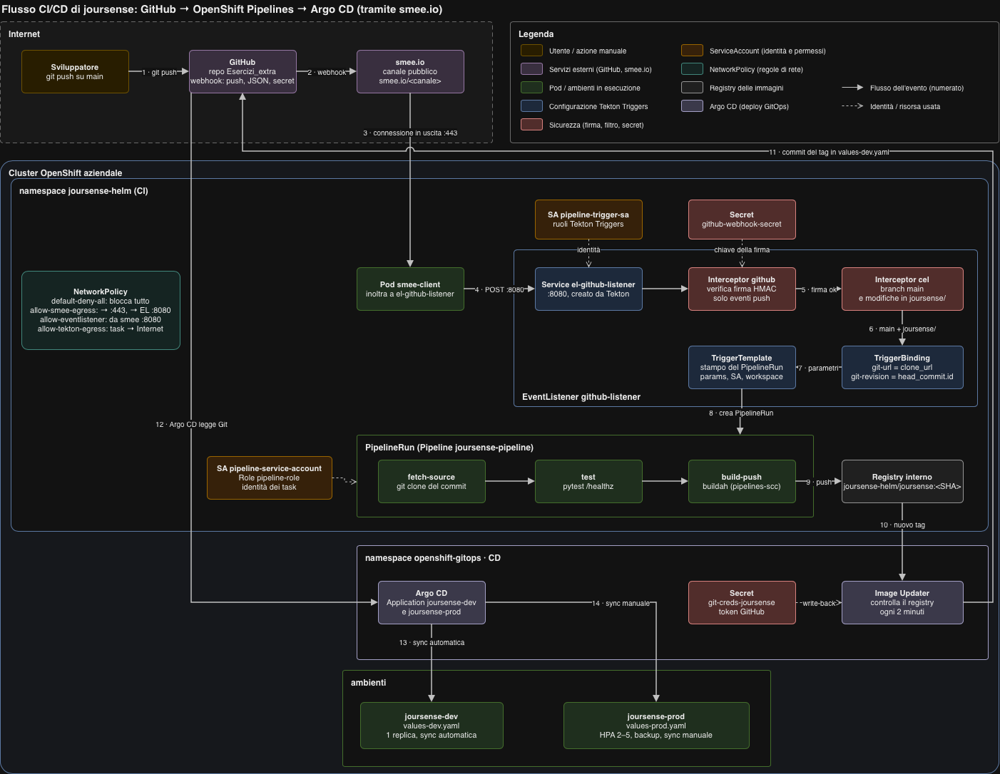

# Pipeline CI di joursense (OpenShift Pipelines / Tekton)

A ogni push su `main` che modifica il codice dell'app, una pipeline Tekton scarica il
codice, esegue i test e costruisce l'immagine. Il **deploy** non è compito della pipeline: dalla
fase 3 lo gestisce Argo CD (vedi [`../argocd/README.md`](../argocd/README.md)).



I numeri sulle frecce seguono il percorso dell'evento: dal push (1) all'immagine nel registry (9)
è il lavoro di questa pipeline; da 10 a 14 proseguono Image Updater e Argo CD.
Le frecce tratteggiate indicano l'identità (ServiceAccount) o la risorsa (Secret) usata in quel
punto.

## File

| File | Oggetto | Ruolo |
|---|---|---|
| `operators/openshift-pipelines-subscription.yaml` | Subscription | installa l'operatore OpenShift Pipelines |
| `tekton/pipeline.yaml` | Pipeline `joursense-pipeline` | i 3 passi: clone, test, build |
| `tekton/task-run-tests.yaml` | Task `run-tests` | esegue `pytest` |
| `tekton/serviceaccount-pipeline.yaml` | ServiceAccount, Role, RoleBinding | identità e permessi della pipeline |
| `tekton/eventlistener-sa.yaml` | ServiceAccount e binding | identità dell'EventListener |
| `tekton/eventlistener.yaml` | EventListener `github-listener` | riceve il webhook e decide se avviare la pipeline |
| `tekton/triggerbinding.yaml` | TriggerBinding | estrae URL e commit dal payload di GitHub |
| `tekton/triggertemplate.yaml` | TriggerTemplate | crea la PipelineRun |
| `tekton/smee-client.yaml` | Deployment `smee-client` | inoltra il webhook da smee.io al cluster |
| `tekton/networkpolicy-webhook.yaml` | NetworkPolicy | aprono il percorso smee-client → EventListener |
| `tekton/task-helm-upgrade-tekton.yaml` | Task `helm-upgrade` | **non più usata**: era il passo di deploy, tolto con Argo CD |
| `joursense/tests/` | test pytest | verificano `/healthz` |

Tutto è nel namespace `joursense-helm`.

## 1. Operatore OpenShift Pipelines

Installato da YAML, tramite OLM, invece che dalla console. Da un cluster-admin:

```bash
oc apply -f joursense-ops/operators/openshift-pipelines-subscription.yaml
oc get csv -n openshift-operators | grep pipelines      # Succeeded
```

La Subscription segue il canale `pipelines-1.24` con aggiornamenti automatici. L'operatore
fornisce Tekton, Tekton Triggers e le Task di cluster usate dalla pipeline
(`git-clone-1-24-0`, `buildah-1-24-0` nel namespace `openshift-pipelines`).

## 2. La pipeline

### I passi

`joursense-pipeline` (`tekton/pipeline.yaml`) ha tre Task. Ognuna ha `runAfter` sulla
precedente: parte solo se quella prima è riuscita, quindi un errore ferma tutti i passi dopo.

| # | Task | Tipo | Cosa fa |
|---|---|---|---|
| 1 | `fetch-source` | `git-clone-1-24-0`, Task di cluster | clona la repo al commit richiesto; produce il risultato `COMMIT` (SHA) |
| 2 | `test` | `run-tests`, nostra | installa le dipendenze ed esegue `pytest` |
| 3 | `build-push` | `buildah-1-24-0`, Task di cluster | costruisce `joursense/Containerfile` e pubblica l'immagine `joursense:<SHA>` sul registry interno |

Le Task di cluster (`git-clone`, `buildah`) sono fornite dall'operatore nel namespace
`openshift-pipelines` e vengono richiamate con `resolver: cluster`: non vanno copiate nella
repo. La Task `run-tests` è nostra, nel namespace `joursense-helm`.

### Dalla CI al deploy

La pipeline si ferma all'immagine nel registry. Da lì:

1. l'**Argo CD Image Updater** vede il nuovo tag e lo scrive in `joursense-helm/values-dev.yaml`
   con un commit su GitHub;
2. **Argo CD** aggiorna `joursense-dev` (sync automatica); `joursense-prod` si aggiorna solo con
   una promozione manuale.

Nella prima versione c'era un quarto passo, `deploy`, con `helm upgrade`. È stato tolto per non
avere due strumenti (Helm dalla pipeline e Argo CD) che modificano le stesse risorse. Il passo
è rimasto commentato in `pipeline.yaml` e la Task in `task-helm-upgrade-tekton.yaml`.

### Parametri

| Parametro | Default | Uso |
|---|---|---|
| `git-url` | (nessuno) | repo da clonare |
| `git-revision` | `main` | branch o SHA da clonare (dal webhook arriva lo SHA del commit) |
| `image` | (nessuno) | immagine senza tag: `image-registry.openshift-image-registry.svc:5000/joursense-helm/joursense` |

### Workspace

Le Task si passano il codice tramite il workspace `source`: per ogni PipelineRun viene creato
un PVC da 1Gi (`volumeClaimTemplate` nel TriggerTemplate). Il passo 1 ci clona la repo, i passi
successivi la trovano lì.

### Tag dell'immagine = SHA del commit

`build-push` pubblica l'immagine con il tag `$(tasks.fetch-source.results.COMMIT)`. Ogni
immagine corrisponde a un commit preciso: dal tag in esecuzione si risale al codice, e
l'Image Updater accetta solo tag di questo tipo (40 caratteri esadecimali), ignorando `latest`.

### Task `run-tests`

- Usa `registry.access.redhat.com/ubi9/python-312`, la stessa immagine base del `Containerfile`:
  i test girano con la stessa versione di Python dell'app.
- Lavora in `joursense/`, installa `requirements-dev.txt` ed esegue `pytest -v`.
- `set -eu`: al primo comando che fallisce lo step si ferma con errore.
- `HOME=/tmp`: OpenShift esegue i container con un utente casuale senza home scrivibile.

### Rete

Il namespace ha una NetworkPolicy `default-deny-all` (dal chart): ogni traffico va aperto
esplicitamente.

| NetworkPolicy | Dove è definita | Pod | Cosa permette |
|---|---|---|---|
| `allow-tekton-egress` | chart (`tekton.egress` in `values.yaml`) | pod delle Task (`app.kubernetes.io/managed-by: tekton-pipelines`) | tutto il traffico in uscita: clone da GitHub, `pip install` da PyPI, push sul registry |
| `allow-smee-egress` | `tekton/networkpolicy-webhook.yaml` | `smee-client` | uscita su 443 (smee.io) e verso l'EventListener su 8080 |
| `allow-eventlistener` | `tekton/networkpolicy-webhook.yaml` | EventListener (`eventlistener: github-listener`) | ingresso solo da `smee-client` su 8080; uscita su 443/6443 (API server, per creare la PipelineRun) e 8443 (interceptor `github` e `cel` di Tekton Triggers) |

L'EventListener accetta connessioni **solo** da `smee-client`: nessun altro pod del namespace
può inviargli eventi.

### Installazione

```bash
oc apply -f joursense-ops/tekton/task-run-tests.yaml
oc apply -f joursense-ops/tekton/pipeline.yaml
oc get pipelines.tekton.dev,tasks.tekton.dev -n joursense-helm
```

### Seguire un'esecuzione

```bash
oc get pipelinerun -n joursense-helm --sort-by=.metadata.creationTimestamp | tail -3
oc get taskrun -n joursense-helm -l tekton.dev/pipelineRun=<nome-pipelinerun>
oc logs -n joursense-helm -l tekton.dev/pipelineRun=<nome-pipelinerun> --all-containers --prefix
```

In console: *Pipelines → PipelineRuns*, con lo stato di ogni Task e i log.

Esito atteso: le tre Task `Succeeded` e la nuova immagine nel registry:

```bash
oc get pipelines.tekton.dev joursense-pipeline -n joursense-helm -o jsonpath='{.spec.tasks[*].name}{"\n"}'
# fetch-source test build-push

oc get istag -n joursense-helm | grep joursense | tail -3
# joursense:<SHA del commit> ...
```

## 3. Test con pytest

In `joursense/tests/`:

| Test | Verifica |
|---|---|
| `test_healthz_risponde_200` | `/healthz` risponde `200` |
| `test_healthz_restituisce_status_ok` | il corpo è `{"status": "ok"}` |
| `test_healthz_non_richiede_login` | nessun redirect al login: OpenShift chiama la probe senza cookie |

- `conftest.py` imposta `DATABASE_URL=sqlite://` **prima** di importare l'app: `app/db.py` crea
  la connessione all'import, e `/healthz` non usa il database. I test girano senza PostgreSQL.
- Il fixture `client` usa `TestClient` di FastAPI: chiama l'app direttamente, senza avviare
  uvicorn.
- Dipendenze dei test in `requirements-dev.txt` (`pytest`, `httpx`); `pytest.ini` aggiunge
  `joursense/` al path.

In locale:

```bash
cd joursense
pip install -r requirements-dev.txt
pytest -v
```

### Se un test fallisce, la pipeline si ferma

Se `pytest` termina con errore, lo step fallisce, la Task `test` fallisce e `build-push` (che
ha `runAfter: test`) non parte. Non viene pubblicata nessuna immagine, quindi l'Image Updater
non ha niente da portare in dev: negli ambienti resta la versione precedente.

Per provarlo, su un branch di prova: modificare un test perché fallisca (per esempio
`assert risposta.status_code == 500`), fare push e lanciare la pipeline su quel branch
(vedi [Lancio manuale](#lancio-manuale)). Nella PipelineRun `test` risulta fallita e
`build-push` non eseguita.

## 4. ServiceAccount dedicato con permessi minimi

La pipeline non usa l'account di un utente né `cluster-admin`, ma il ServiceAccount
**`pipeline-service-account`** (impostato in `taskRunTemplate.serviceAccountName` del
TriggerTemplate).

I permessi sono in un **Role**, valido solo in `joursense-helm`, non in un ClusterRole: niente
in altri namespace e niente RBAC (il ServiceAccount non può darsi altri permessi).

### Permessi necessari alla pipeline attuale

Con la pipeline di sola CI servono:

| Risorse | Verbi | Perché |
|---|---|---|
| `imagestreams` | `get`, `list`, `watch`, `create`, `update`, `patch` | buildah pubblica l'immagine nell'ImageStream `joursense` |
| `imagestreams/layers` | `get`, `update` | push dei layer sul registry interno |
| SCC `pipelines-scc` | `use` | permette alle Task (buildah) di girare con la SCC delle pipeline |

### Permessi del deploy con Helm

Il Role in `serviceaccount-pipeline.yaml` contiene anche i permessi che servivano al passo
`deploy` (`helm upgrade` del chart): `deployments`, `statefulsets`, `secrets`, `services`,
`buildconfigs`, `networkpolicies`, `routes`, `persistentvolumeclaims`, `cronjobs`,
`horizontalpodautoscalers`, `prometheusrules` e lettura di `pods` e `replicasets`.

### Applicazione e verifica

```bash
oc apply -f joursense-ops/tekton/serviceaccount-pipeline.yaml     # da un cluster-admin
```

```bash
SA=system:serviceaccount:joursense-helm:pipeline-service-account
oc auth can-i update imagestreams/layers -n joursense-helm --as=$SA   # yes
oc auth can-i create deployments -n joursense-prod --as=$SA           # no: fuori dal namespace
oc auth can-i create rolebindings -n joursense-helm --as=$SA          # no: niente RBAC
```

L'EventListener ha un suo ServiceAccount, **`pipeline-trigger-sa`**, con i soli ruoli
predefiniti di Tekton Triggers (`tekton-triggers-eventlistener-roles` e
`...-clusterroles`): può leggere le risorse dei trigger e creare PipelineRun, nient'altro.

## 5. Webhook GitHub ed EventListener

### Il percorso dell'evento

GitHub non può raggiungere direttamente il cluster (rete aziendale), quindi l'evento passa
da **smee.io**, un servizio che inoltra i webhook. Con i numeri del diagramma in cima:

1. lo sviluppatore fa `git push` su `main`;
2. GitHub invia il webhook (evento `push`, JSON, firmato con il segreto) al canale smee.io;
3. il pod `smee-client` è collegato al canale con una connessione **in uscita** sulla 443: è
   il cluster che si collega a smee.io, non il contrario, quindi non serve esporre niente;
4. `smee-client` inoltra l'evento con una POST al Service `el-github-listener:8080`;
5. l'interceptor `github` verifica la firma e che sia un `push`;
6. l'interceptor `cel` controlla che il branch sia `main` e che il push modifichi `joursense/`;
7. il TriggerBinding estrae URL della repo e SHA del commit;
8. il TriggerTemplate crea la PipelineRun;
9. `build-push` pubblica l'immagine sul registry interno.

Da qui proseguono, con i numeri da 10 a 14 del diagramma: l'Image Updater vede il nuovo tag (10)
e lo scrive in `values-dev.yaml` con un commit su GitHub (11); Argo CD legge la repo (12) e
aggiorna dev da solo (13), prod solo con un Sync manuale (14). Dettagli in
[`../argocd/README.md`](../argocd/README.md).

### EventListener `github-listener`

Due interceptor, in ordine:

| Interceptor | Cosa fa |
|---|---|
| `github` | verifica la firma con il segreto condiviso (`github-webhook-secret`) e accetta solo eventi `push` |
| `cel` | lascia passare solo i push su `main` che aggiungono, modificano o rimuovono file in `joursense/` |

Il filtro `cel`:

```yaml
value: >-
  body.ref == 'refs/heads/main' &&
  body.commits.exists(c,
    c.added.exists(f, f.startsWith('joursense/')) ||
    c.modified.exists(f, f.startsWith('joursense/')) ||
    c.removed.exists(f, f.startsWith('joursense/')))
```

- L'immagine contiene solo `joursense/`: se un push cambia solo documentazione, chart o file
  di `joursense-ops/`, ricostruirla è inutile.
- L'Image Updater fa commit su `values-dev.yaml`: senza il filtro, ogni suo commit farebbe
  ripartire la pipeline, che produrrebbe un'altra immagine e un altro commit, in un ciclo.
- Il controllo è su **tutti** i commit del push (`body.commits.exists`), non solo l'ultimo.

Poi:

- **TriggerBinding** `github-push-binding`: dal payload prende `repository.clone_url` (URL della
  repo) e `head_commit.id` (lo SHA del commit pushato);
- **TriggerTemplate** `pipeline-template`: crea una PipelineRun di `joursense-pipeline` con quei
  parametri, il ServiceAccount `pipeline-service-account` e un workspace da 1Gi.

Viene clonato esattamente il commit del push, non "l'ultimo di main" al momento dell'avvio.

### Configurazione

Segreto condiviso con GitHub (non è nella repo):

```bash
oc create secret generic github-webhook-secret -n joursense-helm \
  --from-literal=secretToken='<segreto>'
```

Risorse:

```bash
oc apply -f joursense-ops/tekton/eventlistener-sa.yaml           # da un cluster-admin (ClusterRoleBinding)
oc apply -f joursense-ops/tekton/triggerbinding.yaml
oc apply -f joursense-ops/tekton/triggertemplate.yaml
oc apply -f joursense-ops/tekton/eventlistener.yaml
oc apply -f joursense-ops/tekton/smee-client.yaml
oc apply -f joursense-ops/tekton/networkpolicy-webhook.yaml
```

Su GitHub, *Settings → Webhooks → Add webhook*:

| Campo | Valore |
|---|---|
| Payload URL | l'URL del canale smee.io (lo stesso di `smee-client.yaml`) |
| Content type | `application/json` |
| Secret | lo stesso `<segreto>` del Secret `github-webhook-secret` |
| Eventi | *Just the push event* |

L'URL di smee.io è visibile nella repo: chiunque potrebbe inviarci dati, ma l'interceptor
`github` scarta ogni evento senza la firma corretta.

### Verifica

```bash
oc get eventlistener github-listener -n joursense-helm      # AVAILABLE True
oc get pods -n joursense-helm | grep -E "el-github-listener|smee-client"   # Running
oc logs deploy/smee-client -n joursense-helm --tail=5       # eventi inoltrati
```

Dopo un push su `main` che modifica `joursense/`:

```bash
oc get pipelinerun -n joursense-helm --sort-by=.metadata.creationTimestamp | tail -3
```

Compare una nuova `joursense-pipeline-run-...`, e nei log di `smee-client` si vede l'evento
inoltrato. Un push che non tocca `joursense/` arriva all'EventListener ma **non** crea
PipelineRun. Su GitHub, in *Settings → Webhooks → Recent Deliveries*, la consegna verso smee.io
risulta riuscita: quella risposta è di smee.io, quindi la prova che la pipeline è partita è la
nuova PipelineRun.

## Lancio manuale

Per provare la pipeline su un altro branch, senza push su `main`:

```bash
cat <<EOF | oc create -n joursense-helm -f -
apiVersion: tekton.dev/v1
kind: PipelineRun
metadata:
  generateName: joursense-pipeline-run-manuale-
spec:
  pipelineRef:
    name: joursense-pipeline
  taskRunTemplate:
    serviceAccountName: pipeline-service-account
  params:
    - name: git-url
      value: https://github.com/robertaconti2506/Esercizi_extra.git
    - name: git-revision
      value: <branch>
    - name: image
      value: image-registry.openshift-image-registry.svc:5000/joursense-helm/joursense
  workspaces:
    - name: source
      volumeClaimTemplate:
        spec:
          accessModes: ["ReadWriteOnce"]
          resources:
            requests:
              storage: 1Gi
EOF

oc get pipelinerun -n joursense-helm -w
```

`oc create` (non `apply`) perché il nome è generato da `generateName`.

### Prova senza aggiornare dev

L'Image Updater controlla l'immagine `joursense-helm/joursense` e porta in dev il tag costruito
più di recente, da qualunque branch provenga. Una PipelineRun manuale che riesce, con il
parametro `image` di default, porterebbe quindi in dev il codice del branch di prova.

Per evitarlo, nella PipelineRun manuale si pubblica l'immagine con un nome diverso: l'Image
Updater non la vede e dev non cambia.

```yaml
    - name: image
      value: image-registry.openshift-image-registry.svc:5000/joursense-helm/joursense-prova
```

Clone, test e build avvengono come sempre; l'immagine finisce nell'ImageStream
`joursense-prova`. Finita la prova:

```bash
oc delete imagestream joursense-prova -n joursense-helm
```

## Pulizia

Ogni PipelineRun crea un PVC da 1Gi per il workspace, che resta finché la PipelineRun esiste.
Per eliminare quelle fallite (e i loro PVC):

```bash
oc get pipelinerun -n joursense-helm --no-headers | awk '$2=="False" {print $1}' | xargs oc delete pipelinerun -n joursense-helm
```
