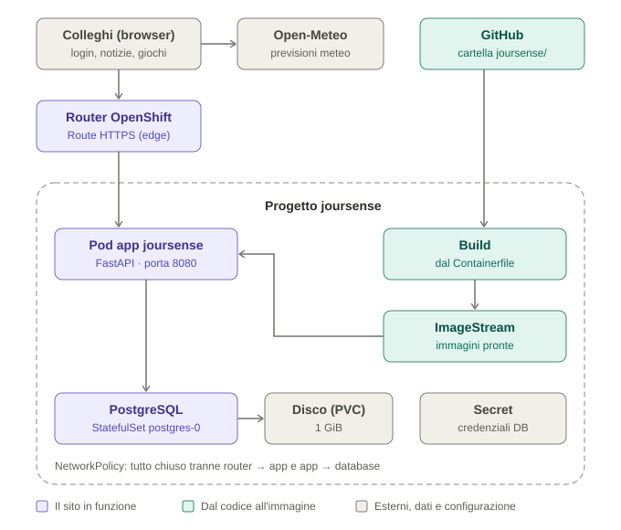

# Joursense — il giornalino aziendale

Joursense è il giornalino interno dell'ufficio: notizie scritte dai colleghi, la classifica degli articoli più letti, il meteo, qualche minigioco per la pausa e l'immancabile dipendente del mese.

È un progetto per imparare a costruire e far girare un'applicazione su **OpenShift**: build da Git, database con disco persistente, probe, Secret, Route HTTPS e NetworkPolicy.

---

## Cosa fa il sito

Tutto il sito è **dietro login**: senza account si vedono solo le pagine di accesso e di registrazione.

| Pagina | Indirizzo | Cosa fa |
|---|---|---|
| Accedi / Registrati | `/login`, `/registrati` | Creazione dell'account (nome, email, password) e accesso. Appena registrati si è già dentro. |
| Notizie | `/` | Ultimi 20 articoli (il più recente in grande) e la classifica dei 5 più letti. |
| Articolo | `/articoli/{id}` | Testo completo; ogni apertura conta una lettura. |
| Scrivi un articolo | `/nuovo` | Titolo, sommario (facoltativo) e testo. La firma è automaticamente il nome di chi è loggato. |
| Elimina articolo | pulsante in fondo all'articolo | Visibile solo all'**autore** e agli **admin**. |
| Meteo | `/meteo` | Tempo attuale e previsioni a 7 giorni, con ricerca della città (dati Open-Meteo). |
| Giochi | `/giochi` | Tris contro il computer, Memory e Snake. I record restano nel browser di ognuno. |
| Dipendente del mese | `/dipendente-del-mese` | Vince sempre Nicolas Cage. Cambia solo la motivazione, e c'è l'albo d'oro degli ultimi 12 mesi. |
| Esci | pulsante in alto | Chiude la sessione. |

Endpoint tecnici, senza login perché li chiama OpenShift:

| Indirizzo | Uso |
|---|---|
| `/healthz` | **Liveness probe**: risponde se il processo Python è vivo. |
| `/readyz` | **Readiness probe**: risponde 200 solo se l'app raggiunge PostgreSQL, altrimenti 503. |

---

## Architettura



Come si legge il disegno:

- **Il sito in funzione (viola).** Il browser dei colleghi arriva al **router di OpenShift**, dove la Route termina l'HTTPS (TLS *edge*). Il router inoltra la richiesta in HTTP, sulla porta 8080, al **pod dell'app** (FastAPI + uvicorn), che legge e scrive su **PostgreSQL** sulla porta 5432. PostgreSQL è uno StatefulSet (`postgres-0`) e tiene i dati su un **disco persistente** (PVC), che sopravvive ai riavvii del pod.
- **Dal codice all'immagine (verde).** Il codice sta su **GitHub**, nella cartella `joursense/`. La **build** lo trasforma in un'immagine con il `Containerfile` e la salva nell'**ImageStream**; da lì il Deployment avvia il nuovo pod dell'app.
- **Esterni, dati e configurazione (grigio).** Il **Secret** contiene le credenziali del database, lette sia da PostgreSQL sia dall'app. Il meteo arriva da **Open-Meteo**: lo chiede direttamente il browser, solo nella pagina Meteo, non l'app.
- **Il riquadro tratteggiato** è il progetto `joursense`: al suo interno le NetworkPolicy chiudono tutto, tranne router → app e app → database.

| Componente | Tecnologia |
|---|---|
| Backend web | Python 3.12, **FastAPI**, server **uvicorn** |
| Pagine | HTML generato dal server con **Jinja2**, un foglio di stile, JavaScript solo per meteo e giochi |
| Database | **PostgreSQL 16** (immagine Red Hat `rhel9/postgresql-16`) |
| Accesso al database | **SQLAlchemy 2** + driver **psycopg 3** |
| Migrazioni | **Alembic**, eseguite automaticamente a ogni avvio del pod |
| Password | **Argon2** (`argon2-cffi`) |
| Immagine container | `registry.access.redhat.com/ubi9/python-312`, gira senza root ed è compatibile con l'UID casuale di OpenShift |

A regime girano **2 pod**: l'app e PostgreSQL. In più compaiono i pod temporanei delle **build**, che finiscono in stato *Completed*.

---

## Risorse su OpenShift

Tutto vive nel progetto (namespace) **`joursense`**.

### Applicazione

| Oggetto | Nome | Note |
|---|---|---|
| BuildConfig | `joursense` | Strategia **Docker**, repo `https://github.com/robertaconti2506/Esercizi_extra.git`, branch `main`, **context dir `/joursense`**, Dockerfile path `Containerfile` |
| ImageStream | `joursense` | Contiene le immagini prodotte dalle build |
| Deployment | `joursense` | Label `app: joursense`, porta 8080, probe HTTP su `/healthz` e `/readyz` |
| Service | `joursense` | Porta 8080 |
| Route | `joursense` | TLS **edge**, traffico http reindirizzato a https |

### Database

| Oggetto | Nome | Note |
|---|---|---|
| Secret | `postgres-credentials` | Chiavi `POSTGRESQL_USER`, `POSTGRESQL_PASSWORD`, `POSTGRESQL_DATABASE` |
| Service | `postgres` | Porta 5432, selector `app: database` |
| StatefulSet | `postgres` | Immagine `registry.redhat.io/rhel9/postgresql-16`, label `app: database`, probe `tcpSocket` sulla 5432 |
| PVC | `postgres-volume-postgres-0` | 1 GiB, `ReadWriteOnce`, montata in **`/var/lib/pgsql/data`**. La crea lo StatefulSet dal `volumeClaimTemplates` |

> **Perché uno StatefulSet e non un Deployment?** Lo StatefulSet dà al pod un nome fisso (`postgres-0`) e lo lega sempre allo stesso disco. Se il pod viene eliminato, ne nasce uno nuovo con gli stessi dati.

---

## Variabili d'ambiente

Si impostano in **Workloads → Deployments → joursense → Environment**. Una modifica riavvia il pod da sola; **non serve rifare la build**.

| Variabile | Obbligatoria | Valore | A cosa serve |
|---|---|---|---|
| `DB_HOST` | sì | `postgres` | Nome del Service del database |
| `DB_NAME` | sì | dal Secret `postgres-credentials`, chiave `POSTGRESQL_DATABASE` | |
| `DB_USER` | sì | dal Secret, chiave `POSTGRESQL_USER` | |
| `DB_PASSWORD` | sì | dal Secret, chiave `POSTGRESQL_PASSWORD` | |
| `DB_PORT` | no | `5432` (default) | |
| `ADMIN_EMAILS` | no | es. `alessandro.segato@gmail.com,roberta.conti@gmail.com` | Email degli **admin**, separate da virgola. Maiuscole e spazi non contano. |

---

## Database e migrazioni

### Come funzionano le migrazioni

Ogni modifica alla struttura del database è un file numerato in `migrations/versions/`. All'avvio del container il comando `alembic upgrade head`:

1. legge in `alembic_version` l'ultima migrazione applicata
2. applica **solo quelle successive**, in ordine
3. se è già tutto aggiornato, non fa nulla

Con più repliche i pod partono insieme: in `migrations/env.py` c'è un **lucchetto di PostgreSQL** (`pg_advisory_lock`) che fa aspettare il secondo pod finché il primo non ha finito.

## Login e sicurezza

- **Password:** salvate come impronta **Argon2**. Chi leggesse il database non potrebbe risalire alle password.
- **Sessioni:** al login si genera un token casuale lungo. Il browser lo riceve in un cookie, nel database se ne salva solo l'impronta SHA-256. Durata **7 giorni**.
- **Cookie:** `HttpOnly` (JavaScript non può leggerlo), `Secure` (solo in https), `SameSite=Lax` (i moduli di altri siti non possono usarlo).
- **Blocco tentativi:** dopo **5 password sbagliate in 15 minuti** sulla stessa email, l'accesso si blocca temporaneamente. Il messaggio d'errore non dice se è sbagliata l'email o la password.
- **Redirect dopo il login:** si torna alla pagina che si stava aprendo, ma solo se è una pagina del sito (niente redirect verso siti esterni).
- **Eliminazione articoli:** il controllo lo fa il **server**, non il pulsante. Una richiesta inviata a mano da chi non è autore né admin riceve `403`.
- **Admin:** decisi solo dalla variabile `ADMIN_EMAILS` nel Deployment. Nessuno può diventare admin dal sito; serve accesso al progetto OpenShift.

---

## NetworkPolicy

Le NetworkPolicy sono un firewall tra i pod. Lo scopo principale qui è che **PostgreSQL sia raggiungibile solo dall'app**: senza policy, qualunque pod di qualunque progetto del cluster (che è un laboratorio condiviso) potrebbe collegarsi alla porta 5432 e provare le password.

Le policy **non** limitano chi apre il sito: gli utenti passano dal router, che ha il permesso. Chi può raggiungere il router (rete aziendale, VPN, Internet) lo decide la configurazione del cluster, non noi.

### Le regole

| # | Nome | Effetto |
|---|---|---|
| 1 | `allow-dns-egress` | Tutti i pod possono interrogare il DNS del cluster (namespace `openshift-dns`, porte 53 e 5353) |
| 2 | `allow-build-egress` | I pod di **build** possono uscire verso Internet (GitHub, PyPI) |
| 3 | `allow-router-to-app` | L'app accetta traffico solo dal router, sulla porta 8080 |
| 4 | `allow-app-egress` | L'app può uscire solo verso PostgreSQL, porta 5432 |
| 5 | `allow-app-to-database` | PostgreSQL accetta connessioni solo dall'app, porta 5432 |
| 6 | `default-deny-all` | Tutto il resto è vietato. **Va creata per ultima.** |

Alcune cose da ricordare:

- Le policy **si sommano**: ognuna aggiunge permessi. Il "vietato" è tutto quello che nessuna regola permette.
- Appena **una** policy seleziona un pod in una direzione (entrata o uscita), per quel pod in quella direzione vale "vietato tutto tranne questo". Per questo la sola `allow-dns-egress` blocca già l'uscita delle build, se manca la `allow-build-egress`.
- Una connessione passa solo se è permessa **in uscita** dal pod di partenza **e in entrata** su quello di arrivo (le policy 4 e 5).
## Come ricreare tutto da zero

Se un giorno il progetto va ricostruito, l'ordine è questo.

**1. Secret del database:** *Workloads → Secrets → Create → Key/value secret*, nome `postgres-credentials`, chiavi `POSTGRESQL_USER`, `POSTGRESQL_PASSWORD`, `POSTGRESQL_DATABASE`. I nomi devono essere esattamente questi, con **QL**.

**2. Service e StatefulSet di PostgreSQL** (Import YAML, uno alla volta):

```yaml
apiVersion: v1
kind: Service
metadata:
  name: postgres
  namespace: joursense
spec:
  selector:
    app: database
  ports:
    - protocol: TCP
      port: 5432
      targetPort: 5432
```

```yaml
apiVersion: apps/v1
kind: StatefulSet
metadata:
  name: postgres
  namespace: joursense
  labels:
    app: database
spec:
  serviceName: postgres
  replicas: 1
  selector:
    matchLabels:
      app: database
  template:
    metadata:
      labels:
        app: database
    spec:
      containers:
        - name: postgres
          image: registry.redhat.io/rhel9/postgresql-16
          ports:
            - containerPort: 5432
          envFrom:
            - secretRef:
                name: postgres-credentials
          volumeMounts:
            - name: postgres-volume
              mountPath: /var/lib/pgsql/data
          readinessProbe:
            tcpSocket:
              port: 5432
            initialDelaySeconds: 5
            periodSeconds: 10
          livenessProbe:
            tcpSocket:
              port: 5432
            initialDelaySeconds: 30
            periodSeconds: 20
          resources:
            requests:
              cpu: 100m
              memory: 256Mi
            limits:
              cpu: 500m
              memory: 512Mi
  volumeClaimTemplates:
    - metadata:
        name: postgres-volume
      spec:
        accessModes: ["ReadWriteOnce"]
        resources:
          requests:
            storage: 1Gi
```

**3. App:** *Developer → +Add → Import from Git*
- Git Repo URL `https://github.com/robertaconti2506/Esercizi_extra.git`; in *Advanced Git options*: reference `main`, context dir `/joursense`
- Import strategy **Dockerfile**, Dockerfile path `Containerfile`
- Name `joursense`, resource type **Deployment**, target port `8080`
- **Create a route** con TLS **Edge** e traffico insicuro **Redirect**
- Variabili d'ambiente: vedi [la tabella](#variabili-dambiente)
- Health checks: readiness `GET /readyz` e liveness `GET /healthz` sulla porta 8080

**4. NetworkPolicy:** le 6 della [sezione dedicata](#networkpolicy), con la `default-deny-all` per ultima.

**5.** Apri il sito, registrati e aggiungi la tua email in `ADMIN_EMAILS`.
